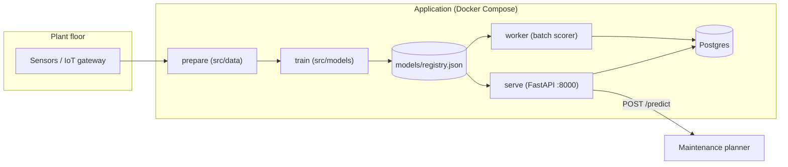

# Predictive Maintenance — AI & Data Analytics

> Remaining-useful-life (RUL) prediction on industrial equipment, deployed as an
> online API **and** a scheduled batch scorer.

This project demonstrates the **AI & Data Analytics** workflow:
tabular sensor data → feature engineering → a cheap, self-trained model →
model registry → **two** serving patterns (on-demand + batch) → Postgres.

Everything runs on a laptop with `uv` + Docker Compose.

## Highlights

- **Model:** scikit-learn `RandomForestRegressor` (300 trees, ~18 s to train on CPU,
  megabytes of RAM, no GPU). Deliberately *not* deep learning — see
  [ADR-0001](docs/adr/0001-model-choice.md).
- **Zero train/serve skew:** training and the API share the *same* causal
  feature-engineering code (`src/features/engineer.py`).
- **Data:** NASA C-MAPSS if reachable, otherwise a fully synthetic,
  reproducible fleet generator — no download required.
- **Serving:** `/predict` REST endpoint (technician asks "how is unit 42?") +
  a batch worker that scores the whole fleet every 30 s into Postgres.
- **Registry:** a single, versioned `models/registry.json` manifest (no external
  MLflow server to operate — see [ADR-0003](docs/adr/0003-model-registry.md)).

## Quickstart

```bash
uv sync                      # install deps (Python >=3.11)
uv run pytest                # unit + integration tests

uv run python -m src.data.prepare     # generate/prepare data -> data/processed/
uv run python -m src.models.train     # train + register -> models/

# online API (local, no Postgres needed)
uv run uvicorn src.serving.app:app --reload
curl http://127.0.0.1:8000/docs      # OpenAPI UI

# full stack: Postgres + API + batch worker
uv run python -m src.seed            # load sensor readings into Postgres
docker compose -f infra/docker-compose.yml up --build
```

A sample `/predict` call (last 20 cycles of raw sensor readings):

```bash
curl -X POST http://127.0.0.1:8000/predict \
  -H "Content-Type: application/json" \
  -d '{"unit": 42, "rows": [{"cycle": 1, "s_1": 99.1, ...}, ...]}'
```

## Architecture at a glance (C4 Container)



Context and component views, plus runtime/deployment details, are in
[`docs/arc42.md`](docs/arc42.md).

## Repository layout

```
src/data/       raw data (C-MAPSS downloader, synthetic generator, prepare)
src/features/   causal rolling-window feature engineering (shared train/serve)
src/models/     training + registry + metrics
src/serving/    FastAPI app, predictor, batch scorer
src/db.py       Postgres helpers (schema, seeding)
infra/          docker-compose.yml, schema.sql
docs/           arc42.md + ADRs
tests/          pytest suite
```

## Decisions

| # | Decision | Rationale |
|---|----------|-----------|
| [ADR-0001](docs/adr/0001-model-choice.md) | RandomForest over deep learning | Tabular data, CPU-only serving, low maintenance cost |
| [ADR-0002](docs/adr/0002-serving-strategy.md) | Online API **and** scheduled batch | Two real consumption patterns (on-demand vs fleet-wide) |
| [ADR-0003](docs/adr/0003-model-registry.md) | Plain versioned JSON registry | No MLflow server to operate for a vertical slice |
| [ADR-0004](docs/adr/0004-orchestration.md) | In-process scheduler instead of Airflow | Simplicity; Airflow noted as the production path |

Full architecture documentation: [`docs/arc42.md`](docs/arc42.md).
