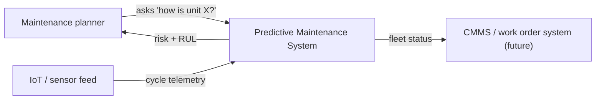
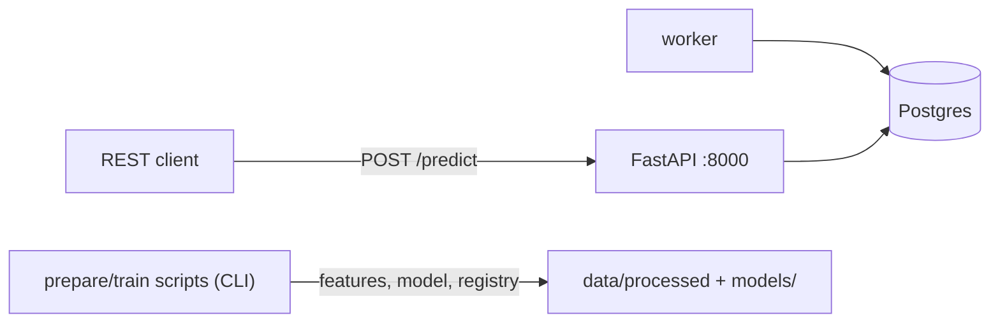
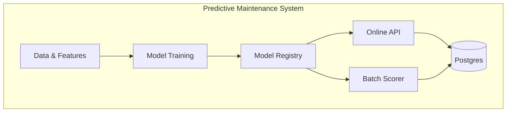
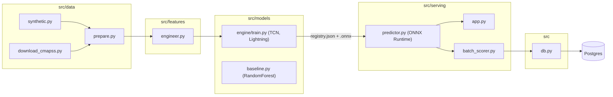
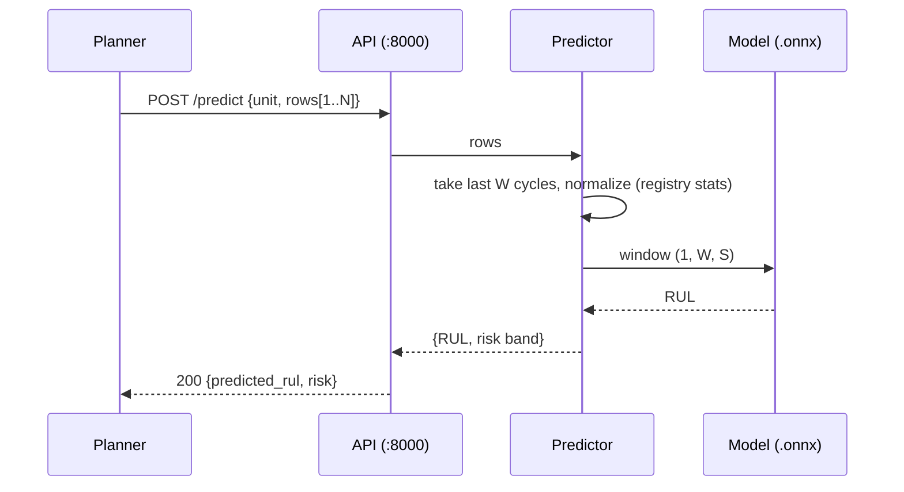
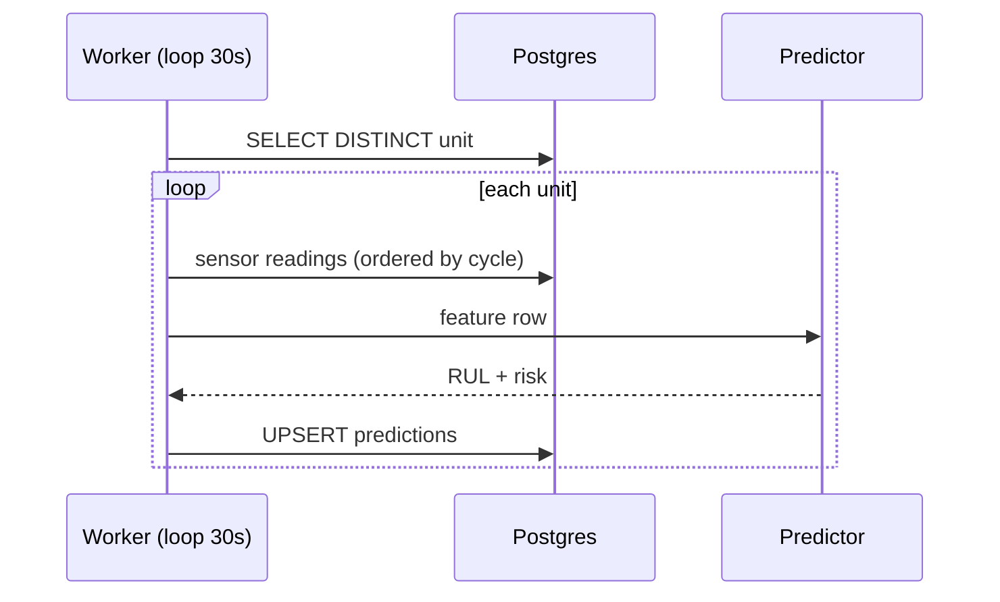
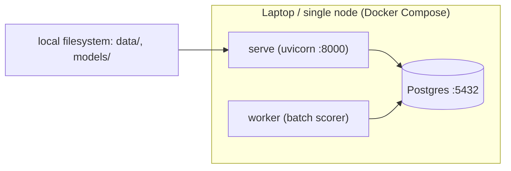

# Predictive Maintenance — Architecture (arc42)

- **arc42 version:** 8
- **Status:** vertical slice / showcase
- **Domain:** AI & Data Analytics — predictive maintenance
- **Audience:** architects, data scientists, engineers evaluating this reference example

---

## 1. Introduction and Goals

### 1.1 Requirements Overview

Predict maintenance demand for a fleet of industrial machines. Given the recent
sensor history of a machine, estimate its remaining useful life (RUL) and a
risk band so that maintenance can be planned before failure — without
over-maintaining healthy machines.

### 1.2 Quality Goals

| Priority | Goal | Description |
|----------|------|-------------|
| 1 | **Maintenance cost** | Model must be cheap to train, re-train and serve (CPU-only, no GPU) |
| 1 | **Predictability** | Same code path for training and serving → no train/serve skew |
| 2 | **Transparency** | Every model is registered with metrics and feature schema; results are auditable |
| 3 | **Portability** | Runs on a laptop with `uv` + Docker; no proprietary services |

### 1.3 Stakeholders

- Data scientist (trains, evaluates, registers models)
- Platform/backend engineer (operates API + batch worker)
- Maintenance planner (consumes predictions)

## 2. Constraints

- Python >=3.11, dependencies managed with `uv`.
- Local-first: Docker Compose, no cloud accounts.
- Data must be obtainable without authentication (synthetic fallback).
- Non-functional: a single worker must score the entire fleet in seconds.

## 3. Context and Scope

### 3.1 Business Context

### 3.2 Technical Context

## 4. Solution Strategy

- **Batch-first analytics** on raw sensor time-series (sequence windows).
- **Efficacy-first deep model** (TCN on raw sensor windows) over a classical
  efficiency-first tabular baseline, because the workload runs offline in the
  cloud (ADR-0001). The RandomForest on rolling features is kept as a baseline
  for the comparison.
- **Two serving patterns** (ADR-0002): a low-latency REST endpoint for
  on-demand queries and a scheduled batch scorer for fleet-wide status.
- **Lightweight versioned registry** (ADR-0003) and an **in-process scheduler**
  (ADR-0004) to keep operations trivial.
- **Shared preprocessing** (last-`W`-cycles window + train-set per-sensor
  statistics) between training and serving to guarantee consistency.

## 5. Building Block View

### 5.1 Level 1 — System

### 5.2 Level 2 — Components

## 6. Runtime View

### 6.1 On-demand prediction

### 6.2 Batch fleet scoring

## 7. Deployment View

- `serve` and `worker` share one image built from the uv base image; both load
  the model from the copied `models/` directory.
- `db` initialises its schema via `infra/schema.sql`.

## 8. Cross-cutting Concepts

- **Preprocessing consistency:** the deep model and the API share the *same*
  contract — the last `W` sensor cycles, normalized with the train-set
  per-sensor statistics stored in the registry (zero train/serve skew). The
  rolling-window features in `engineer.py` are used only by the RandomForest
  baseline.
- **Split discipline:** train/test are split *by unit* so the test fleet is
  truly out-of-sample (no unit appears in both).
- **Registry as source of truth:** `models/registry.json` stores the window
  length, sensor order, normalization statistics, metrics and version → models
  are self-describing.
- **Observability:** the batch worker logs scoring duration/unit counts; the API
  exposes `/health` and `/model`.
- **Configuration:** `.env` (see `.env.example`) for DB URL and risk thresholds.

## 9. Architecture Decisions

- [ADR-0001: Model choice — efficacy-first TCN over an efficiency-first tabular model](adr/0001-model-choice.md)
- [ADR-0002: Serving strategy — online + batch](adr/0002-serving-strategy.md)
- [ADR-0003: Model registry without a registry server](adr/0003-model-registry.md)
- [ADR-0004: Orchestration without Airflow](adr/0004-orchestration.md)

## 10. Quality Requirements & Verification

| Quality | Verification |
|---------|--------------|
| Maintainability | 13 pytest tests; single-command `uv run pytest` |
| Reproducibility | synthetic data seeded; `uv.lock` committed; Docker image pinned to uv base |
| Model quality | comparison harness (TCN vs RandomForest) in `models/*metrics*.json` |
| Preprocessing correctness | window shape/causality + normalization assertions in tests |

## 11. Risks and Technical Debt

- **Synthetic data** understates real-world sensor noise; real C-MAPSS or
  factory data is the production path (ADR-0001).
- **No drift monitoring / retraining loop** yet — flagged for a future iteration.
- **Single-node Postgres** — fine for a slice; production would use managed
  storage and an orchestrated pipeline (ADR-0004).

## 12. Glossary

| Term | Definition |
|------|-----------|
| RUL | Remaining useful life, in cycles, before failure |
| Unit | A single machine whose sensors are tracked over cycles |
| Cycle | One operational period of a unit |
| C-MAPSS | NASA turbofan degradation dataset |
| Train/serve skew | Difference between the data a model saw in training vs. at serving time |
