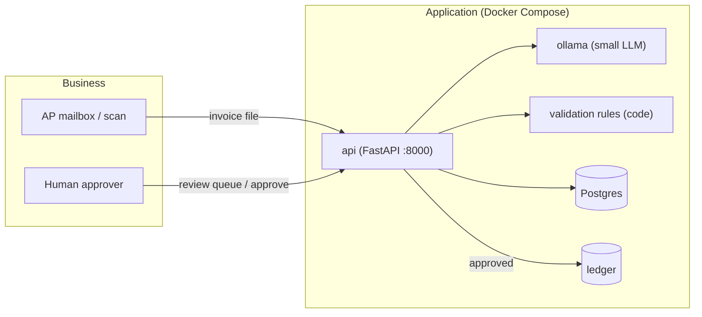

# Invoice Automation — AI for Automation

> A small, open-source LLM turns unstructured supplier invoices into validated
> data — then **takes an action**: auto-approves and posts them to the ledger,
> or sends them to a human for review.

This project demonstrates the **AI for Automation** workflow and is the
deliberate contrast to Project 1 (data analytics): the goal is not to *predict*
something but to *do* something — automate a business process end-to-end.

## Highlights

- **Model:** a small quantized open-source LLM (`qwen2.5:1.5b-instruct`) served
  **locally** with [Ollama](https://ollama.com) — no proprietary API, no data
  leaves the machine (see [ADR-0001](docs/adr/0001-open-source-llm.md)).
- **LLM for the unstructured part, code for the verification:** the LLM
  extracts JSON; Pydantic enforces the schema and deterministic business rules
  validate the numbers ([ADR-0003](docs/adr/0003-structured-output.md)).
- **Human-in-the-loop:** invoices that fail validation or exceed a threshold go
  to a review queue; approval posts them to a ledger
  ([ADR-0004](docs/adr/0004-human-in-the-loop.md)).
- **Fully local + private:** Ollama + Postgres + FastAPI in Docker Compose.

## Quickstart

### Option A — full stack with Docker Compose

```bash
docker compose -f infra/docker-compose.yml up --build
# first run pulls the model into Ollama (~1 GB) - be patient
```

### Option B — run the API locally

```bash
uv sync
# 1. install + start Ollama yourself, then:
ollama pull qwen2.5:1.5b-instruct
# 2. start Postgres (e.g. docker run -d -p 5433:5432 -e POSTGRES_USER=invoice
#    -e POSTGRES_PASSWORD=invoice -e POSTGRES_DB=invoice postgres:16)
# 3. run the API
uv run uvicorn src.serving.app:app --reload
```

### Process an invoice

```bash
curl -X POST http://127.0.0.1:8000/invoices/process \
  -F "file=@data/sample_invoices/invoice_001.txt"
```

| Sample file | What happens |
|-------------|--------------|
| `invoice_001.txt` | clean, under threshold → **approved**, posted to ledger |
| `invoice_002.txt` | valid but over threshold → **review** |
| `invoice_003.txt` | line-item sum ≠ subtotal → **review** (validation caught it) |

Review and act:

```bash
curl http://127.0.0.1:8000/invoices?status=review
curl -X POST http://127.0.0.1:8000/invoices/1/approve
curl -X POST http://127.0.0.1:8000/invoices/1/reject
```

## Architecture at a glance (C4 Container)



Context, component and runtime views are in [`docs/arc42.md`](docs/arc42.md).

## Repository layout

```
src/core/      schema.py (structured output), llm.py (Ollama client),
               validation.py (business rules), storage.py (Postgres + ledger)
src/ingest/    document -> text (txt/md/pdf)
src/serving/   FastAPI app (process, review queue, approve/reject)
data/sample_invoices/   three sample invoices exercising every path
infra/         docker-compose.yml (db + ollama + api), schema.sql
docs/          arc42.md + ADRs
tests/         pytest suite (validation, schema, ingest)
```

## Decisions

| # | Decision | Rationale |
|---|----------|-----------|
| [ADR-0001](docs/adr/0001-open-source-llm.md) | Open-source LLM over proprietary API | Cost, privacy, self-hosting; a 1.5B model is enough for the task |
| [ADR-0002](docs/adr/0002-ollama.md) | Ollama for local model serving | Zero-config runtime, quantization, runs on CPU |
| [ADR-0003](docs/adr/0003-structured-output.md) | Prompt-to-JSON + Pydantic enforcement | Deterministic guardrails on top of probabilistic output |
| [ADR-0004](docs/adr/0004-human-in-the-loop.md) | Human approval for exceptions | Automation where it's safe; oversight where it matters |

Full architecture documentation: [`docs/arc42.md`](docs/arc42.md).
