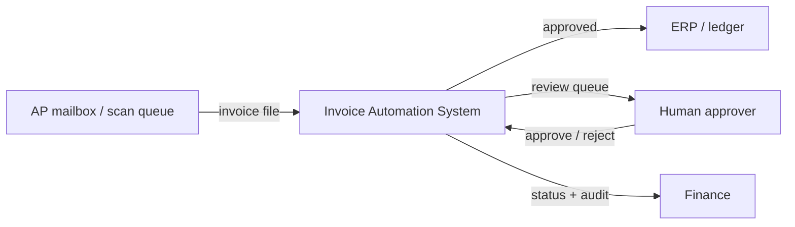
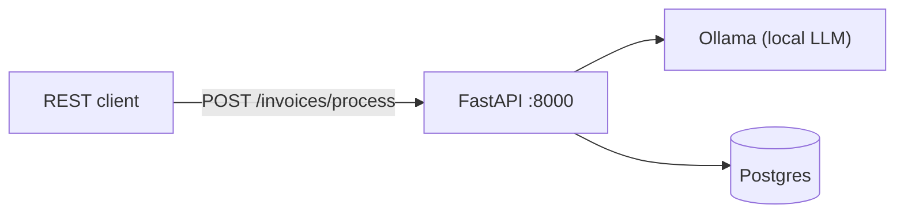
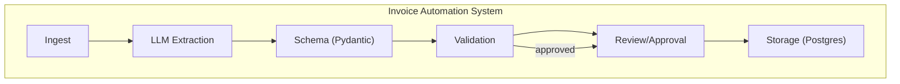
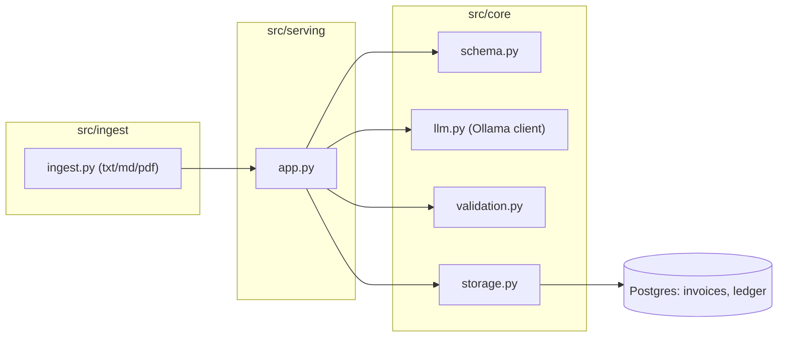
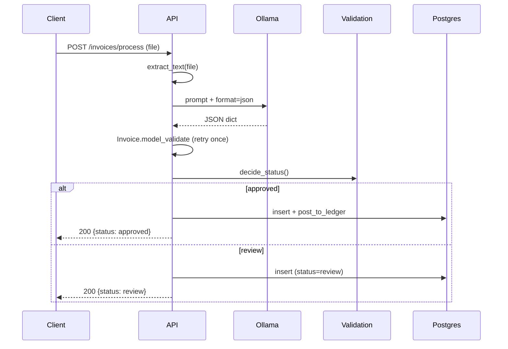
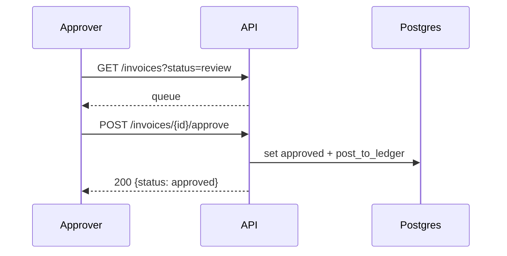
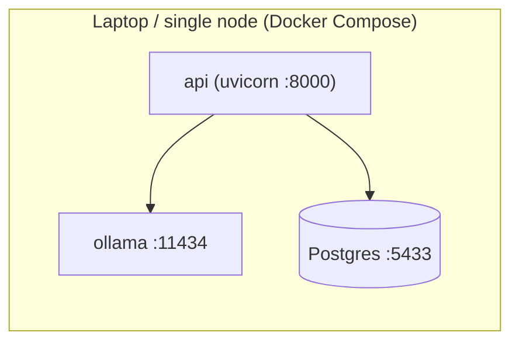

# Invoice Automation — Architecture (arc42)

- **arc42 version:** 8
- **Status:** vertical slice / showcase
- **Domain:** AI for Automation — document-processing workflow
- **Audience:** architects, data scientists, engineers evaluating this reference example

---

## 1. Introduction and Goals

### 1.1 Requirements Overview

Automate supplier invoice processing: read unstructured invoices (as scanned
text or PDF), extract the relevant fields, validate them against business
rules, and either auto-post to the ledger or route to a human approver.

### 1.2 Quality Goals

| Priority | Goal | Description |
|----------|------|-------------|
| 1 | **Maintenance cost** | Small self-hosted model, no per-call fees, no vendor lock-in |
| 1 | **Privacy** | Document contents never leave the machine |
| 2 | **Correctness/guardrails** | Probabilistic LLM output is fenced by schema + deterministic rules |
| 2 | **Oversight** | Every exception is visible in a review queue with an audit trail |
| 3 | **Portability** | Runs on a laptop with `uv` + Docker Compose |

### 1.3 Stakeholders

- Business/process owner (defines rules, reviews exceptions)
- Data scientist / prompt engineer (maintains the extraction prompt)
- Platform engineer (operates Ollama + API + Postgres)
- Finance (audits the ledger)

## 2. Constraints

- Python >=3.11, dependencies managed with `uv`.
- Local-first: Docker Compose, no cloud accounts, no paid API.
- The extraction step must produce **structured** data (JSON) fitting a fixed schema.
- Decisions that affect money require human sign-off by default.

## 3. Context and Scope

### 3.1 Business Context

### 3.2 Technical Context

## 4. Solution Strategy

- **Automation, not prediction:** the system performs an action (post to ledger).
- **Split responsibility:** the LLM handles *unstructured reading*; code handles
  *verification and action* (ADR-0003).
- **Small open-source model** served locally via Ollama (ADR-0001, ADR-0002).
- **Human-in-the-loop** as the safety net (ADR-0004).

## 5. Building Block View

### 5.1 Level 1 — System

### 5.2 Level 2 — Components

## 6. Runtime View

### 6.1 Process an invoice

### 6.2 Human review

## 7. Deployment View

- `ollama` keeps its model store in a named volume; first start pulls the model.
- `db` initialises `invoices` + `ledger` via `infra/schema.sql`.

## 8. Cross-cutting Concepts

- **Structured output:** the only contract between the LLM and the system is
  JSON fitting `src/core/schema.py`; everything downstream is typed Pydantic.
- **Defense in depth:** prompt → JSON schema → business rules → human review.
- **Audit trail:** `invoices` stores the full extracted JSON, status and who
  reviewed; `ledger` records the posting action.
- **Idempotent review:** approve/reject are safe to call multiple times.
- **Configuration:** `.env` (see `.env.example`) for model, Ollama URL, DB and
  the review amount threshold.

## 9. Architecture Decisions

- [ADR-0001: Open-source LLM over proprietary API](adr/0001-open-source-llm.md)
- [ADR-0002: Ollama for local model serving](adr/0002-ollama.md)
- [ADR-0003: Structured output — prompt-to-JSON + Pydantic](adr/0003-structured-output.md)
- [ADR-0004: Human-in-the-loop for approval](adr/0004-human-in-the-loop.md)

## 10. Quality Requirements & Verification

| Quality | Verification |
|---------|--------------|
| Maintainability | 15 pytest tests (validation, schema, ingest); `uv run pytest` |
| Reproducibility | `uv.lock` committed; compose image pinned to uv base |
| Guardrails | schema + business-rule tests assert rejection of bad input |
| Runtime honesty | Ollama failures surface as a clean 503, not a crash |

## 11. Risks and Technical Debt

- **Extraction quality** depends on the chosen model and prompt; mitigation is
  the schema-retry loop and the review queue.
- **No retraining loop** — prompt tuning is the "training" surface here.
- **PDFs** rely on `pdfminer` (text layer only); scanned invoices would need OCR.
- **Single threshold** (amount) — real systems add vendor whitelists and
  duplicate detection.

## 12. Glossary

| Term | Definition |
|------|-----------|
| LLM | Large language model |
| Ollama | Local runtime for serving open-source LLMs |
| Structured output | JSON that conforms to a fixed schema |
| Human-in-the-loop | A person reviews/approves actions the automation is not trusted to take alone |
| Ledger | The record of approved/posting actions |
