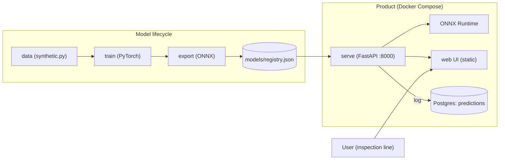

# Defect Inspection — AI as a Product

> A steel-surface defect classifier (6 defect classes) trained on a small CNN,
> exported to ONNX, and shipped as a product: a versioned model + inference API
> + web UI + prediction telemetry.

This project demonstrates the **AI as a Product** workflow — the third
architecture in the series. Unlike analytics (Project 1) and process automation
(Project 2), here the AI *is* the product end-users consume directly: you upload
a surface image and get a defect classification with confidence, backed by a
proper model lifecycle.

## Highlights

- **Model:** a self-trained CNN (~60k parameters) from scratch in PyTorch —
  no pretrained backbone, no GPU needed. Trains to **~99% validation accuracy**
  in under a minute on CPU (see [ADR-0001](docs/adr/0001-cnn-choice.md)).
- **Deployment:** the trained model is exported to **ONNX** and served with
  **ONNX Runtime** — the serving image doesn't even install PyTorch
  ([ADR-0002](docs/adr/0002-onnx.md)).
- **Product lifecycle:** a self-describing model registry (artifact + class
  names + exact preprocessing contract), a REST API, a web UI, and optional
  prediction logging to Postgres for drift/monitoring
  ([ADR-0003](docs/adr/0003-registry-monitoring.md)).
- **Data:** a reproducible procedural generator that mimics the six NEU
  steel-surface defect classes; swap in the real NEU dataset with one env var
  ([ADR-0004](docs/adr/0004-data-strategy.md)).

## Quickstart

```bash
uv sync                      # installs deps incl. dev (PyTorch for training)

# 1. generate data + train + export ONNX
uv run python -m src.data.synthetic --per-class 150
uv run python -m src.models.train --epochs 12

# 2. serve locally (ONNX Runtime only - no PyTorch in the serving process)
uv run uvicorn src.serving.app:app --reload
open http://127.0.0.1:8000        # web UI: upload a surface image
```

Try it from the API:

```bash
curl -X POST http://127.0.0.1:8000/predict/image \
  -F "file=@data/raw/synthetic/scratches/img_0000.png"
# {"class": "scratches", "confidence": 0.87, "probabilities": {...}}
```

Full stack with prediction logging (Postgres):

```bash
docker compose -f infra/docker-compose.yml up --build
```

## Architecture at a glance (C4 Container)



Context, component and runtime views are in [`docs/arc42.md`](docs/arc42.md).

## Repository layout

```
src/data/       synthetic.py (procedural NEU-like generator), dataset.py,
                download_neu.py (optional real dataset)
src/models/     train.py (CNN, evaluation, ONNX export, registry)
src/serving/    app.py (ONNX Runtime API), static/ (web UI)
infra/          docker-compose.yml (db + serve), schema.sql
docs/           arc42.md + ADRs
tests/          pytest suite
```

## Decisions

| # | Decision | Rationale |
|---|----------|-----------|
| [ADR-0001](docs/adr/0001-cnn-choice.md) | Small CNN from scratch over a pretrained backbone | Tiny, cheap, fast to train/retrain; enough for the task |
| [ADR-0002](docs/adr/0002-onnx.md) | ONNX + ONNX Runtime at serving time | Small footprint, no PyTorch in prod, portable artifact |
| [ADR-0003](docs/adr/0003-registry-monitoring.md) | Self-describing registry + prediction logging | Versioned, auditable, drift-ready product telemetry |
| [ADR-0004](docs/adr/0004-data-strategy.md) | Synthetic generator with real-dataset swap | Fully reproducible, offline, configurable |

Full architecture documentation: [`docs/arc42.md`](docs/arc42.md).
