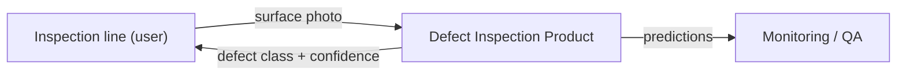
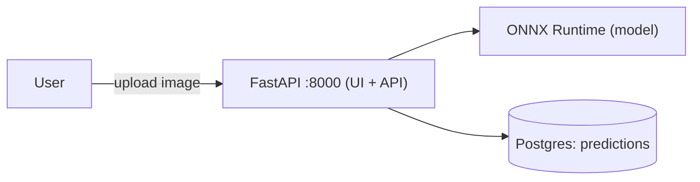
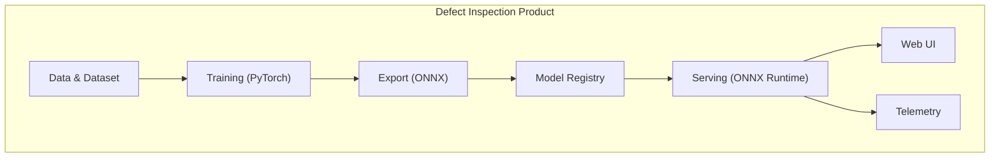
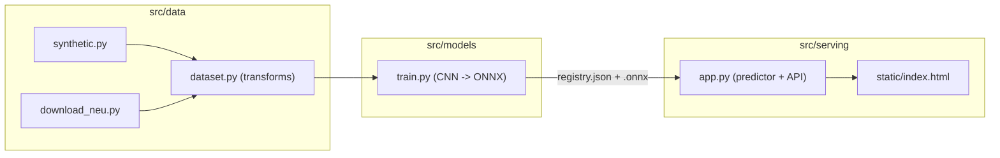
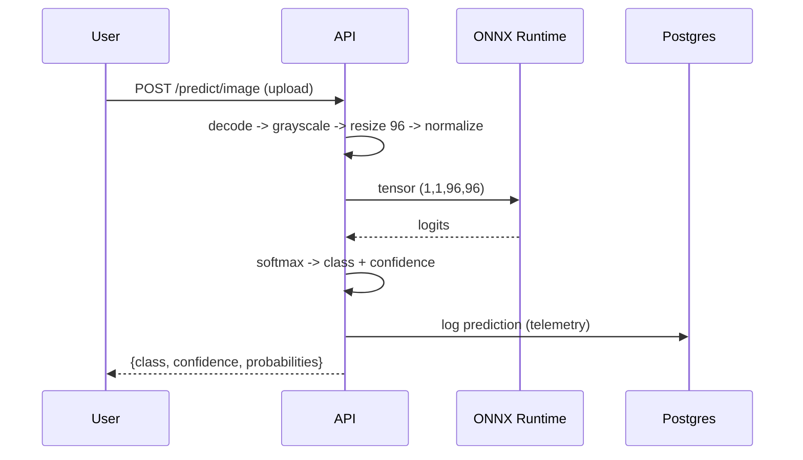
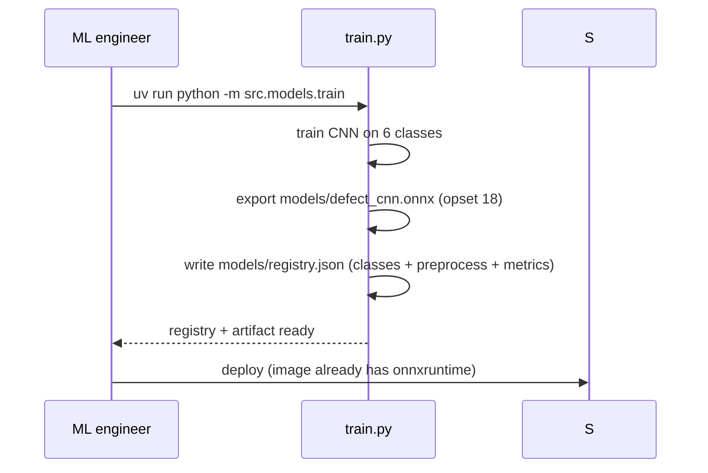
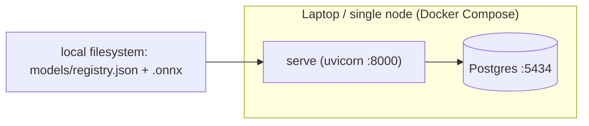

# Defect Inspection — Architecture (arc42)

- **arc42 version:** 8
- **Status:** vertical slice / showcase
- **Domain:** AI as a Product — image classification (manufacturing quality control)
- **Audience:** architects, data scientists, engineers evaluating this reference example

---

## 1. Introduction and Goals

### 1.1 Requirements Overview

Build a product that classifies steel-surface defects from a single photo into
one of six classes (crazing, inclusion, patches, pitted surface, rolled-in
scale, scratches), with confidence, over a versioned model lifecycle.

### 1.2 Quality Goals

| Priority | Goal | Description |
|----------|------|-------------|
| 1 | **Maintenance cost** | Small self-trained model; cheap, frequent retraining on CPU |
| 1 | **Computational efficiency** | ~60k-parameter CNN; ONNX Runtime serving without PyTorch |
| 2 | **Product experience** | Easy consumption: REST API + web UI + confidence scores |
| 2 | **Lifecycle governance** | Versioned artifact, self-describing registry, prediction telemetry |
| 3 | **Portability** | Runs on a laptop with `uv` + Docker; no cloud accounts |

### 1.3 Stakeholders

- Product owner (defines the interface the model exposes to users)
- ML engineer (trains, evaluates, exports, registers models)
- Platform engineer (operates serving + telemetry)
- Quality inspectors (consume predictions via the UI/API)

## 2. Constraints

- Python >=3.11, dependencies managed with `uv`.
- Local-first: Docker Compose, no cloud accounts, CPU-only training and serving.
- The serving process must not depend on the training framework (ADR-0002).
- The artifact must encode its own contract (class names + preprocessing).

## 3. Context and Scope

### 3.1 Business Context

### 3.2 Technical Context

## 4. Solution Strategy

- **Train small, serve light:** a compact CNN trained from scratch; export to
  ONNX and serve with ONNX Runtime (ADR-0001/0002).
- **Self-describing artifact:** the registry carries class names and the exact
  preprocessing pipeline so serving can't drift from training (ADR-0003).
- **Product telemetry:** every prediction is logged (optional) for monitoring
  and drift detection (ADR-0003).
- **Reproducible data:** procedural generator by default, real NEU dataset
  optional (ADR-0004).

## 5. Building Block View

### 5.1 Level 1 — System

### 5.2 Level 2 — Components

## 6. Runtime View

### 6.1 Classification request

### 6.2 Training & release

## 7. Deployment View

- The serving image is built from the uv base and installs **only the runtime
  dependencies** (ONNX Runtime), not PyTorch (ADR-0002).
- Training runs on the host (or a dev container) and writes `models/` before
  `docker compose up --build`.

## 8. Cross-cutting Concepts

- **Preprocessing contract:** `dataset.py` defines resize size, mean/std; the
  same values are stored in the registry and applied byte-for-byte by the
  serving predictor. Tested by `tests/test_dataset.py` and `test_serving.py`.
- **Self-describing artifacts:** the registry is the single source of truth for
  classes, input name and metrics.
- **Telemetry:** prediction logging is best-effort (never fails the request)
  and gated on `DATABASE_URL` being set.
- **Reproducibility:** data generator and training both use fixed seeds;
  `uv.lock` is committed.
- **Configuration:** `.env` (see `.env.example`) for DB and optional NEU URL.

## 9. Architecture Decisions

- [ADR-0001: Small CNN from scratch over a pretrained backbone](adr/0001-cnn-choice.md)
- [ADR-0002: ONNX + ONNX Runtime over PyTorch at serving time](adr/0002-onnx.md)
- [ADR-0003: Self-describing registry + prediction telemetry](adr/0003-registry-monitoring.md)
- [ADR-0004: Data strategy — synthetic default, real dataset optional](adr/0004-data-strategy.md)

## 10. Quality Requirements & Verification

| Quality | Verification |
|---------|--------------|
| Maintainability | 8 pytest tests; `uv run pytest` |
| Reproducibility | seeded generator + training; `uv.lock` committed |
| Model quality | ~99% validation accuracy (see `models/metrics.json`) |
| Train/serve consistency | shared preprocessing contract tested end-to-end |
| Product robustness | garbage input returns 422; logging never breaks requests |

## 11. Risks and Technical Debt

- **Synthetic data** understates real-world imaging conditions; the NEU dataset
  (or factory photos) is the production path (ADR-0004).
- **No automated retraining loop or drift alerts** yet — telemetry exists, the
  trigger does not.
- **Static, no auth** UI/API — fine for a slice; production needs auth, rate
  limits and an image quarantine/annotation pipeline.
- **ONNX opset pinned to 18** — fine for onnxruntime; revisit on upgrades.

## 12. Glossary

| Term | Definition |
|------|-----------|
| ONNX | Open Neural Network eXchange — portable model format |
| ONNX Runtime | Cross-platform inference engine for ONNX models |
| Registry | The versioned manifest describing a model and its contract |
| Crazing/inclusion/patches/pitting/rolled-in-scale/scratches | The six NEU steel-surface defect classes |
| Telemetry | Logged prediction data used for monitoring and drift detection |
